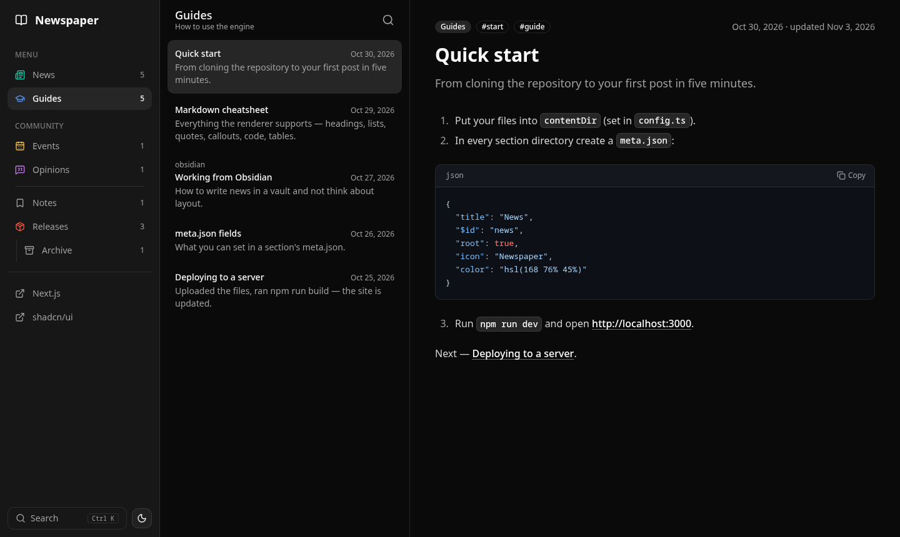

# Newspaper

**A file-based news engine.** Point it at a folder of markdown files — an Obsidian vault, for example — and get a fast three-column news site: menu, feed, reader. No database, no logins, no users.



- **Just files.** The site structure is built by walking the content directory. Sort order comes from file creation time; edits show up as "updated".
- **fumadocs-style metadata.** `title`, `description`, `tags` from the frontmatter, and `meta.json` per directory (`title`, `description`, `icon`, `color`, `pages`) for the menu.
- **Obsidian-friendly.** `[[wikilinks]]`, `![[image.png]]` embeds, callouts (`> [!note]`), nested folders.
- **Search out of the box.** Full-text, typo-tolerant, no external service — <kbd>Ctrl</kbd>+<kbd>K</kbd>.
- **Infinite scroll** in the feed and in the `<NewsList />` component.
- Dark / light / system theme. Responsive: three columns from 1024px, a single column on mobile.

Stack: Next.js 16 (App Router) · React 19 · Tailwind CSS 4 · shadcn/ui · react-markdown · MiniSearch.

## Quick start

Requires Node.js **20.9+**.

```bash
npm install
npm run dev        # http://localhost:3000
```

The demo content in `./content` is used by default. To use your own folder, set `contentDir` in [`config.ts`](config.ts):

```ts
export const config = {
  contentDir: "./content",            // relative to the project root, or an absolute path
  links: [{ title: "Next.js", href: "https://nextjs.org" }],
  showDrafts: false,                  // show documents with `draft: true`
};
```

## Production

```bash
npm run build
npm start          # PORT=8080 npm start to change the port
```

The workflow is: edit files (e.g. in Obsidian) → upload them to the server → `npm run build` → restart `npm start`.

Section feeds, article pages and search read the files at request time, so a new file already shows up there without a rebuild. The home page and the menu counters are prerendered, so they update after the next `npm run build`.

## Content structure

```
content/
├── meta.json            # the site itself: title, description, icon, pages
├── index.mdx            # home page (optional)
├── news/
│   ├── meta.json        # { "root": true, ... } → a menu item
│   ├── 2026/launch.md   # nested folders are fine
│   └── cover.svg
└── releases/
    ├── meta.json
    └── archive/
        └── meta.json    # a nested "root" folder → a child item in the menu
```

### `meta.json`

A directory with `"root": true` becomes a menu item.

```json
{
  "title": "News",
  "description": "What is happening with the project",
  "$id": "news",
  "root": true,
  "icon": "Newspaper",
  "color": "hsl(168 76% 45%)",
  "pages": ["launch", "---", "..."]
}
```

| Field | Meaning |
| --- | --- |
| `root` | `true` — the directory is a menu item. Nested `root` folders form a tree |
| `title`, `description` | menu label and feed subtitle |
| `$id` | URL segment (defaults to the folder path) |
| `icon` | any [lucide](https://lucide.dev/icons) icon name in PascalCase (`Cpu`, `FlaskConical`) |
| `color` | icon color |
| `order` | optional number, orders items when `pages` doesn't |
| `pages` | ordering, see below |

`meta.json` in the **content root** describes the site: `title` is the site name, `description` the tagline, `icon` the logo.

Folders in parentheses, like `(root)`, are not part of the URL. Files outside any `root` folder are ignored.

### `pages` and `---`

Works like in fumadocs:

- In the **content root** `meta.json` or a section's `meta.json`, `pages` orders **child menu items** (by folder name, path or `$id`). Unlisted items go to the end, or to the `"..."` position.
- In a **section's** `meta.json`, `pages` also **pins posts** to the top of its feed, in the given order (`"index"`, `"sub/post"`). Posts listed after `"..."` go to the bottom, everything else is sorted by date.
- `"---"` is a separator, `"---Label---"` a separator with a caption (menu only).

```json
{ "pages": ["news", "guides", "---Community---", "events", "---", "..."] }
```

### Frontmatter

```md
---
title: Newspaper is live
description: Shown in the feed and under the title.
tags: [launch, engine]
date: 2026-11-03
image: https://example.com/cover.png
draft: false
---
```

| Field | Fallback |
| --- | --- |
| `title` | first `# H1`, then the file name |
| `description` | first ~200 characters of the text |
| `date` | file creation time (modification time if unavailable) |
| `tags` | none; each tag has a page at `/tag/<tag>` |

"Updated" is the file's modification time. Invalid YAML in one file doesn't break the site — the header is parsed leniently and a warning is logged.

### Landing page

Opening a section shows its `index.md(x)` (in the section root) if there is one, otherwise the first post of its feed. The home page does the same with the `index.md(x)` in the content root.

### Post list in any page

```md
<NewsList />
<NewsList section="news" />
<NewsList tag="release" />
```

Renders a list of posts that loads more as you scroll. Handy for `index.mdx`.

### Supported markdown

GFM (tables, task lists, strikethrough), syntax-highlighted code with a copy button, Obsidian callouts (`note`, `info`, `tip`, `success`, `warning`, `danger`, `error`, `quote`), `[[wikilinks]]` and `![[embeds]]`, raw HTML. `.mdx` files are read as markdown — `import`/`export` lines are dropped, JSX components are not rendered.

## Project layout

```
config.ts          engine config
lib/content.ts     directory walk, frontmatter, meta.json, menu tree, ordering
lib/feed.ts        feed pagination
lib/markdown.ts    Obsidian syntax → markdown
app/               routes: /, /[section], /[section]/[...slug], /tag/[tag], /api/search, /api/feed, /files/*
components/        UI (sidebar, feed, reader, search, theme toggle) and components/ui (shadcn)
content/           demo content
```

## Scripts

| Command | |
| --- | --- |
| `npm run dev` | dev server with live reload |
| `npm run build` | production build |
| `npm start` | serve the production build |
| `npm run lint` | ESLint |
